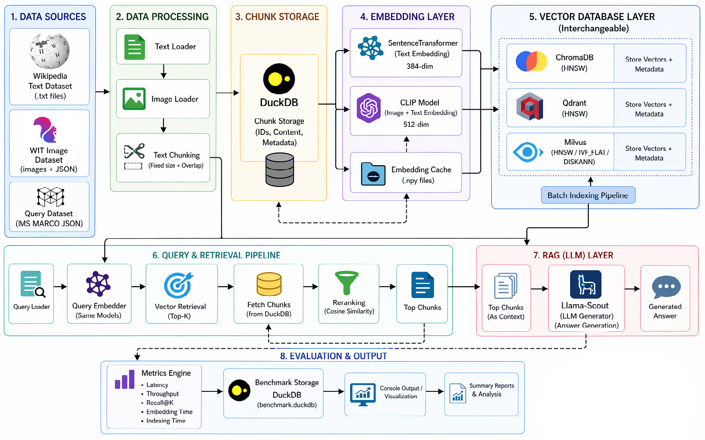

# Vector Database Benchmarking for Multimodal Semantic Search

This project compares ChromaDB, Qdrant, and Milvus as retrieval layers for semantic search and retrieval-augmented generation. Developed as a graduate independent study at Indiana University Bloomington under Prof. Feng Chen, the benchmark keeps preprocessing, embeddings, query inputs, and evaluation procedures consistent while changing the database and index configuration. The text branch uses Wikipedia passages embedded with MiniLM, while the multimodal branch uses CLIP to place Wikipedia images and captions in a shared vector space. DuckDB stores passage text, metadata, and benchmark records so that retrieved vector IDs can be resolved into readable evidence. The study examines query latency, batch throughput, retrieval quality, indexing time, and workload scaling, then connects retrieved passages to Llama-Scout for grounded answer generation. The [final report](mom/Final_Report_Vdb.pdf) describes the methodology, results, and interpretation of the experiments.

## Study Scope

- **Database comparison:** ChromaDB and Qdrant with HNSW, and Milvus with HNSW, IVF_FLAT, and DISKANN.
- **Text retrieval:** semantic search over overlapping passages from English Wikipedia articles.
- **Multimodal retrieval:** text-to-image search using aligned Wikipedia Image Text dataset pairs and CLIP embeddings.
- **Workload scaling:** separate comparisons of corpus growth and increasing query-batch size.
- **RAG integration:** passage retrieval, metadata lookup, context assembly, and answer generation using retrieved evidence.

## Data and Embeddings

The report organizes the benchmark around three text-corpus sizes and three image-text collection sizes. Article counts and vector counts are different because each article can produce several passages, and each aligned multimodal pair contributes an image vector and a text vector.

- **Wikipedia text:** 1,000, 10,000, and 100,000 articles, corresponding to 6,284, 62,941, and 629,118 passage vectors in the report.
- **Wikipedia Image Text pairs:** 1,000, 5,000, and 25,000 aligned pairs, corresponding to 2,000, 10,000, and 50,000 vectors.
- **Query workloads:** batches of 1,000, 5,000, and 10,000 queries, with longer sweeps used for the query-scaling visualization. Text workloads include MS MARCO queries and article-derived prompts; multimodal prompts are based on captions and caption variants.
- **Text encoder:** `sentence-transformers/all-MiniLM-L6-v2`, producing 384-dimensional embeddings.
- **Multimodal encoder:** `openai/clip-vit-base-patch32`, producing 512-dimensional text and image embeddings.

Vectors use `float32`, L2 normalization, and cosine-based comparison. Embeddings are cached and reused across indexing and evaluation runs to avoid repeating preprocessing work.

## Retrieval Pipeline

The pipeline separates data preparation from database-specific operations so that each database can be evaluated with the same surrounding workload.

- **Load and clean data:** read Wikipedia text or aligned image-caption records, remove empty lines and trivial boilerplate, and normalize whitespace.
- **Create passages:** split text into windows of 500 characters with 50-character overlap. Prepend the article title to the first passage and retain informative trailing passages.
- **Store content and provenance:** assign stable identifiers based on the source page and passage offset. Keep passage text and metadata in DuckDB, with image IDs, captions, article IDs, and keywords for multimodal records.
- **Generate embeddings:** encode passages with MiniLM or text and images with CLIP, normalize the vectors, and reuse cached embeddings for repeated comparisons.
- **Build the selected index:** create the database collection, insert vectors in batches, build the index, load it, and prepare it for querying.
- **Execute retrieval:** embed queries with the matching model and request the top-K results through the database layer.
- **Resolve and evaluate results:** fetch content by ID, record timing and quality metrics, and prepare selected passages for reranking and RAG.

## Databases and Index Settings

The report aligns the principal parameters where the database APIs allow comparable settings. The same configuration is retained across scales rather than independently retuning every workload.

- **ChromaDB HNSW:** cosine distance, `max_neighbors=16`, `ef_construction=128`, and `ef_search=128`.
- **Qdrant HNSW:** `m=16`, `ef_construct=128`, and query-time `hnsw_ef=128`.
- **Milvus HNSW:** `M=16`, `efConstruction=128`, and query-time `ef=128`.
- **Milvus IVF_FLAT:** `nlist=1024` and query-time `nprobe=32`.
- **Milvus DISKANN:** query-time `search_list=128`; the report retains the documented build defaults for `MaxDegree=56` and `SearchListSize=100`.

Milvus is deployed in standalone Docker mode. Python provides the benchmark orchestration and database clients, with DuckDB, NumPy, pandas, PyTorch, Transformers, Sentence Transformers, and dataset-loading libraries supporting the pipeline.

## Evaluation Method

Embedding generation is excluded from the timed retrieval calls, while embedding and indexing times are recorded separately. This distinguishes search-call latency from the cost of preparing and running the full pipeline.

- **Average latency:** mean time spent in the measured search call for a query.
- **Batch throughput:** number of queries divided by the wall-clock duration of the recorded batch. It is not simply the inverse of average search-call latency.
- **Recall@K:** fraction of the relevant reference items recovered within the top-K results, averaged over queries.
- **Precision@K:** fraction of the returned K items that belong to the relevant reference set, averaged over queries.
- **Indexing and total time:** separate measurements for index construction and the broader execution workflow. The scale-up table includes embedding, indexing, and query processing in its total time.

The text reference set uses exact FAISS flat search over the same normalized embeddings, supplemented by source-aware positives for article-derived queries. The multimodal reference uses aligned image-caption pairs and their metadata. The report examines retrieval quality at K values of 1, 3, 5, and 10.

## Results Reported in the Final Study

### Measured 1K Baseline

The report identifies the 1K text baseline as its validated measurement over a 1K Wikipedia collection and 1,000 MS MARCO queries. The reported values are:

- **Qdrant HNSW:** 4.6 ms average search-call latency, 117.09 queries per second, and 8.54 seconds total batch time.
- **Milvus HNSW:** 4.8 ms average search-call latency, 111.51 queries per second, and 8.97 seconds total batch time.
- **ChromaDB HNSW:** 5.0 ms average search-call latency, 109.65 queries per second, and 9.12 seconds total batch time.
- **Milvus IVF_FLAT:** 6.8 ms average search-call latency, 96.89 queries per second, and 10.32 seconds total batch time.
- **Milvus DISKANN:** 7.3 ms average search-call latency, 90.58 queries per second, and 11.04 seconds total batch time.

Qdrant HNSW leads this baseline on latency and throughput, with Milvus HNSW close behind. These numbers describe this workload and configuration rather than a universal ranking of the databases.

### Scale-Up and Retrieval Quality

The report's abstract and introduction describe the 10K and 100K expansion as estimated or projected scale-up analysis, while later sections discuss those scales as experimental runs. The larger-scale figures below are therefore presented as report findings, separately from the explicitly validated 1K baseline.

- **Corpus growth:** the report describes HNSW as favorable at small and medium text scales, with Milvus offering additional index choices as collection size and memory pressure increase.
- **100K scale-up summary:** Table IV reports 63.13 queries per second and 9.1 ms average latency for Milvus DISKANN, compared with 52.85 queries per second and 10.4 ms for Qdrant HNSW. These figures belong to the larger-scale analysis described above.
- **10K quality summary:** Table V reports Recall@10 of 0.95 and Precision@10 of 0.84 for Qdrant HNSW. ChromaDB HNSW and Milvus HNSW each have reported Recall@10 of 0.94, with Precision@10 of 0.81 and 0.83 respectively.
- **Query-load growth:** the query-scaling figure shows ChromaDB with the gentlest increase in total batch time. This is a different comparison from increasing the size of the indexed corpus.
- **Overall interpretation:** database choice depends on retrieval quality, query volume, collection size, and resource constraints. The study does not identify one configuration as best for every workload.

## Multimodal Retrieval and RAG

CLIP allows a text prompt to be compared directly with image embeddings in a shared 512-dimensional space. The multimodal branch reuses the database interface and top-K workflow, while associated captions and article metadata make the retrieved images easier to inspect.

For text-based RAG, retrieved IDs are resolved to passage text in DuckDB. The pipeline uses a lightweight cosine-similarity reranking step, selects three or five passages, and can stitch neighboring passages from the same source into the context. Llama-Scout, accessed through Indiana University's ReALLMS platform, generates an answer from that evidence.

The report discusses RAG grounding qualitatively and does not provide a separate image-only performance table or a numerical answer-quality score. Its RAG observations concern the usefulness, provenance, and continuity of the retrieved context.

## Repository Guide

- [phase_1](phase_1/): initial database experiments, Wikipedia and WIT data preparation, and query-loading notebooks.
- [phase_2/main.py](phase_2/main.py): benchmark orchestration and selection of database and index configuration.
- [phase_2/data_loader.py](phase_2/data_loader.py): text and image loading and passage preparation.
- [phase_2/embedder.py](phase_2/embedder.py) and [model_loader.py](phase_2/model_loader.py): embedding generation and model loading.
- [phase_2/chunk_db.py](phase_2/chunk_db.py): DuckDB storage and retrieval of passage and image metadata.
- [phase_2/vector_db](phase_2/vector_db/): ChromaDB, Qdrant, and Milvus implementations.
- [phase_2/query_loader.py](phase_2/query_loader.py) and [query_engine.py](phase_2/query_engine.py): query preparation, retrieval, and reranking.
- [phase_2/db_logger.py](phase_2/db_logger.py) and [display.py](phase_2/display.py): benchmark record storage and result summaries.
- [phase_2/rag.py](phase_2/rag.py): answer-generation integration.
- [mom/viz](mom/viz/): benchmark result files, plotting code, and figures.
- [Final report](mom/Final_Report_Vdb.pdf): methodology, experiment tables, architecture, discussion, and references for the graduate independent study.

## Further Work

The report proposes comparing DuckDB-backed passage storage with file-based alternatives, evaluating generated answers more systematically, and adding a web interface for benchmark configuration and result inspection. Additional modalities and alternative embedding models are also proposed as extensions to the retrieval framework.
